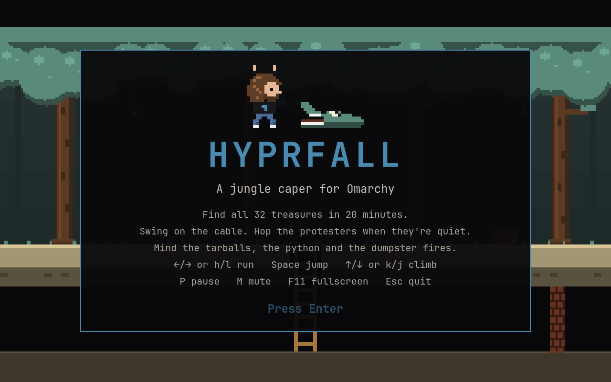
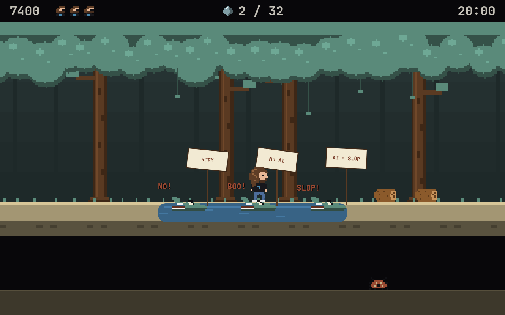
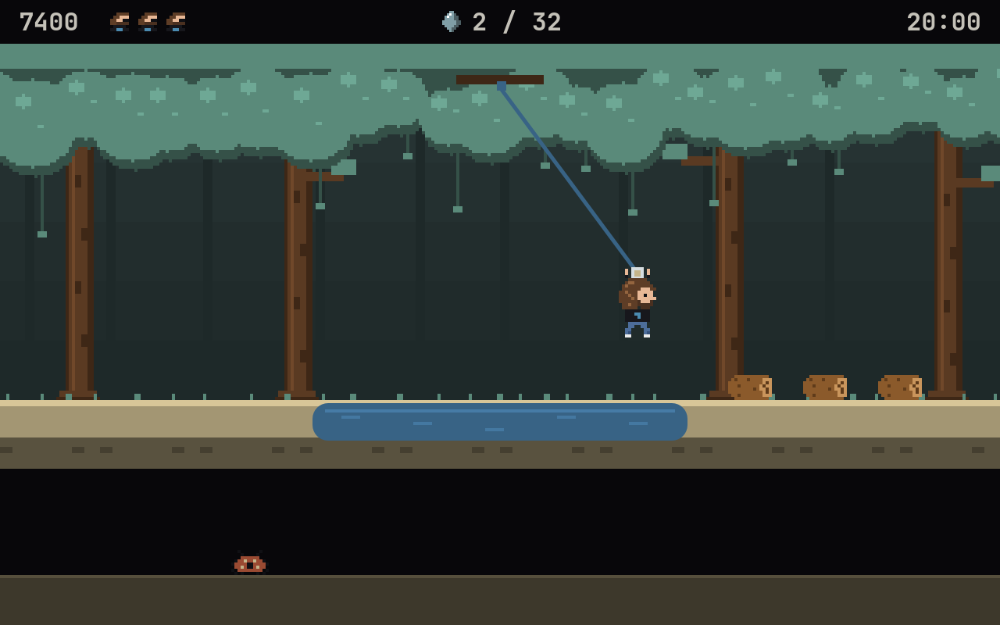
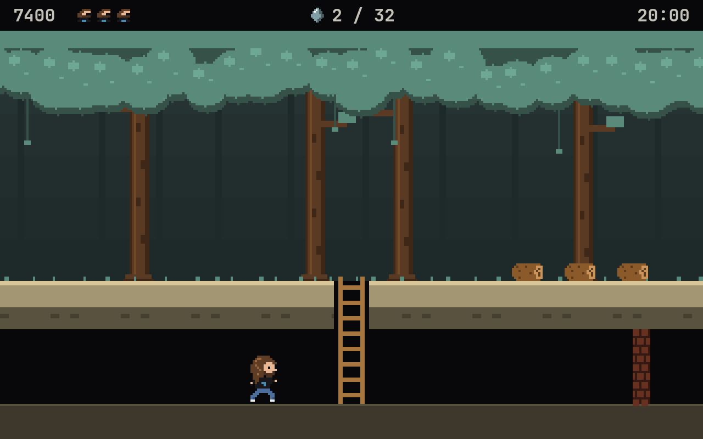
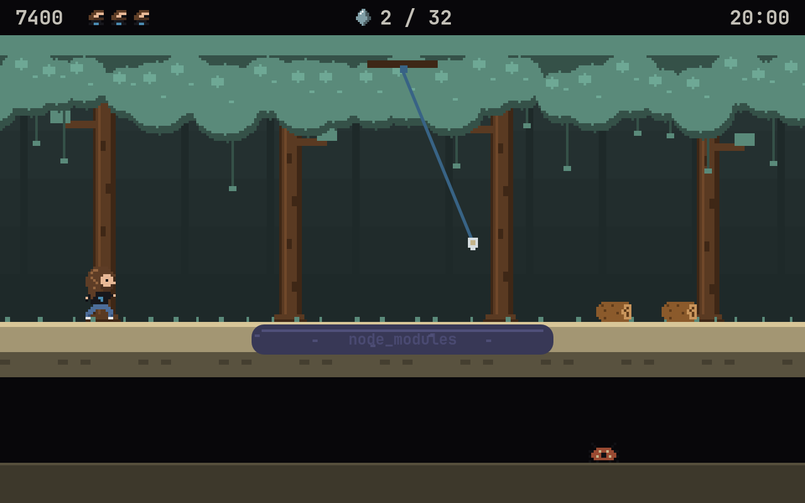

# Hyprfall

*Swing on the cable. Hop the protesters. Don't fall in the node_modules.*

Remember the summer of '82? You held a joystick with one stiff red button,
ran right for about a thousand screens, and screamed at a crocodile. That
crocodile still owes you an apology.

**Hyprfall** is a jungle platformer in that spirit, built as a native Omarchy
app. Our hero (a certain Danish racing driver with shoulder-length hair, a
beard and a black tee) has twenty minutes to find 32 treasures scattered across 255
screens of jungle. Between him and the loot: tarballs, dependency hell, a
python, the odd dumpster fire, and a swamp full of gators holding picket
signs that say **NO AI**.

<p align="center">
  
</p>

## What's in it

- **255 screens of jungle in a ring.** Each screen comes from one byte,
  walked with a reversible 8-bit LFSR, so walking left brings back exactly
  the screens you passed. Same jungle every game; learn it like it's 1983.
- **An ethernet cable to swing on.** Jump for the plug, ride it across, let
  go with ↓ or Space on the far side. Fumble it and enjoy the tar.
- **The anti-AI caucus of the swamp.** Gators up to their eyes in water,
  waving signs like *RTFM*, *STOP VIBING* and *WRITE IT BY HAND*. When
  they're quiet, their heads are stepping stones. When they start yelling,
  get off.
- **Things that roll and burn.** Rolling logs (`journalctl -f`) knock points
  off but won't kill you. A python will (should've used Ruby), and so will
  a dumpster fire.
- **Pits that breathe.** Tarballs and a purple pool of `node_modules` open
  and close on a timer. Wait it out, or swing.
- **A tunnel underneath.** Take a ladder down and every screen you walk
  underground skips three up top. Watch for firewalls and the bug that
  lives down there. It works on its machine.
- **Treasure worth finding.** Golden Keycaps (2,000), Rubies (3,000), Arch
  Idols (4,000) and Hypr Crystals (5,000). Find all 32 before the clock hits
  0:00. Falling down a hole costs 100; you get three lives.
- **It sounds the part.** An original adventure-rock soundtrack: a galloping
  E-minor title riff and a driving A-minor jungle run, fuzzed power chords,
  a lead with bends, and a drum kit, plus a dozen sound effects. All of it
  generated from scratch by a little synth in `tools/make-sounds.py`.

<p align="center">
  
  
</p>
<p align="center">
  
  
</p>

## Native to Omarchy

- **Wears your theme, the whole jungle.** The canopy is your theme's green,
  the swamp its blue, the logo on the hero's tee its accent, the gators' angry little
  mouths its red. Run `omarchy theme set` mid-game and the jungle repaints
  itself while you play. Skin, hair and wood keep fixed colours so the hero
  stays recognisable on every theme.
- **Runs on Quickshell,** the same engine as the Omarchy shell. No Electron,
  no browser, no emulator, and on Omarchy nothing extra to install.
- **Plays nice with Hyprland.** It opens as a centered, floating 16:10 window
  sized to your monitor, and launching it again just focuses the one that's
  already open. F11 goes fullscreen.
- **Vim keys work.** h/l to run, k/j to climb. Of course they do.

## Controls

| Key | Does |
|-----|------|
| ← → or h l or a d | Run |
| Space (or ↑ when you're not at a ladder) | Jump |
| ↑ ↓ or k j | Climb ladders; ↓ or Space lets go of the cable |
| P or Esc | Pause |
| M | Mute |
| F11 | Fullscreen |
| Enter | Start, unpause, play again |

## Install

```bash
git clone https://github.com/ninepointlabs/hyprfall ~/Projects/hyprfall
cd ~/Projects/hyprfall
./install.sh
```

Then launch **Hyprfall** from the app launcher (Super + Space), or run
`hyprfall`. The installer only writes to your home directory:

| What | Where |
|------|-------|
| The game | `~/.local/share/hyprfall/` |
| Launcher | `~/.local/bin/hyprfall` |
| App entry | `~/.local/share/applications/hyprfall.desktop` |
| Icon | `~/.local/share/icons/hicolor/256x256/apps/hyprfall.png` |
| High scores | `~/.local/state/hyprfall/save.json` |

Run `./install.sh` again after pulling to update. `hyprfall --tiled` skips
the floating window if you'd rather let Hyprland tile it.

Want a key for it? Add this to `~/.config/hypr/bindings.lua`:

```lua
o.bind("SUPER + SHIFT + ALT + J", "Hyprfall", "~/.local/bin/hyprfall")
```

### Remove

```bash
./install.sh --uninstall   # keeps your high scores
./install.sh --purge       # takes them too
```

### Away from Omarchy

You need a Wayland desktop with [Quickshell](https://quickshell.org); Qt 6
multimedia for sound and `jq` for the launcher's window placement are
optional. `install.sh` checks for them and names the package for your
distro. Without an Omarchy theme the jungle uses a built-in Tokyo Night
palette.

## Development

```bash
node test/engine.js          # engine: the LFSR ring, every screen crossable, fuzzed random play
test/ui.sh                   # headless end-to-end UI test with real key events
tools/snap.sh /tmp/shots start scene:protest time:3 at:164,128 shot:gators.png
python3 tools/make-sounds.py # regenerate app/sounds/
python3 tools/make-icon.py   # regenerate assets/icon.png (needs ImageMagick)
```

The engine (`app/Engine.js`) is plain JavaScript stepped at a fixed 60 Hz, so
node tests it directly; the QML only draws and plays sounds. The tests check
that a real jump sequence gets across every kind of screen, so a physics
tweak that makes a swamp impossible fails CI instead of your evening.

## Credits and disclaimers

An affectionate parody. The jungle, the sprites, the code and the music are
all original; nothing here comes from any 1982 cartridge, and this isn't
affiliated with or endorsed by Activision, Omarchy's creator, 37signals, or
any gator. The hero is a fond caricature. The protesting gators are a joke
at a debate, not at anyone in it; some of them make good points, and they
all have excellent signs.

MIT licensed. Made by [Ninepoint Labs](https://ninepointlabs.com).
